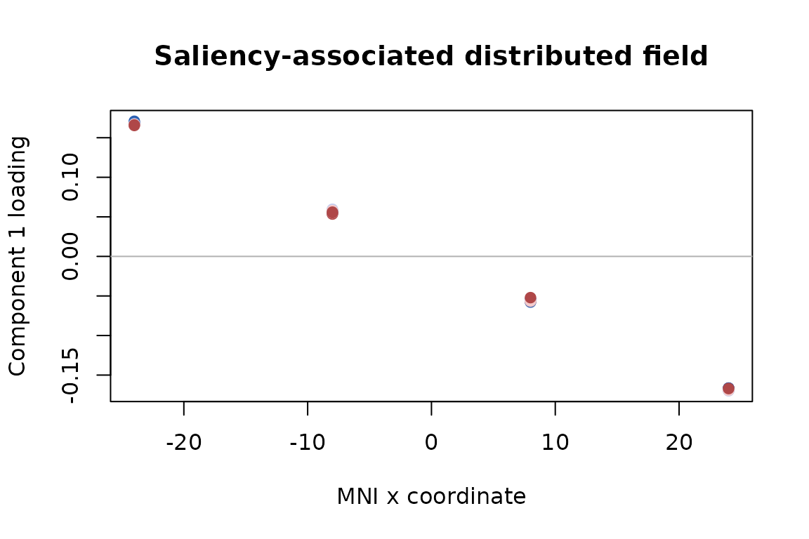

# Find Distributed Design Effects in Trialwise Brain Fields

A trialwise fMRI analysis often leaves you with one beta volume per
trial. You may then want to know which *distributed* activation patterns
are associated with saliency, probe type, confidence, or an
interaction–without first averaging trials into cells and without
letting subjects with more trials dominate the group result.

[`design_mfa()`](https://bbuchsbaum.github.io/muscal/reference/design_mfa.md)
answers that question term by term. For each requested design effect it
returns a conditional effect size, a trajectory over an explicit
reference design, and one or more group-level spatial loading fields.
The result is a design decomposition: components maximize fitted
variation for a named term, rather than total variation in the brain
fields.

This article follows one complete analysis and then treats missing
cells, rank selection, soft spatial correspondence, and uncertainty as
extensions.

``` r

library(muscal)
```

## What goes in, and what comes out?

For each subject `s`, you supply two matching objects:

- `Y[[s]]`: an `n_s`-by-`p_s` matrix with trials in rows and brain
  features in columns;
- `design[[s]]`: a data frame with `n_s` rows and the trial annotations
  used in an ordinary R formula.

The common-grid case uses the same uniquely named features for every
subject. The soft-alignment case, introduced later, allows
subject-specific features linked by sparse spatial maps.

The calculation has a simple sequence:

``` text
trial annotations + trialwise fields
            |
            v
 full and reduced design fits for one named term
            |
            v
 effect matrix on a population reference grid
            |
            v
 design trajectory  x  spatial loading field
```

Subject intercepts are included in both the full and reduced fits. By
default, each subject contributes equal total weight even when trial
counts differ. Trials remain the modeling rows, while subjects remain
the population units for held-out validation and resampling.

Despite the API name, this is an ASCA+/partial-RDA-style design
decomposition. It does not perform the block normalization that defines
multiple factor analysis (MFA).

## What does the example look like?

The example has five ordered saliency levels, three probe types, four
ordered confidence ratings, and two runs. Saliency and probe are
experimentally controlled. Confidence is observed, so its result will be
interpreted as a conditional association rather than a causal effect.

``` r

input_overview
#>   subject trials features
#> 1      S1    120       64
#> 2      S2    135       64
#> 3      S3    150       64
#> 4      S4    165       64
#> 5      S5    180       64
#> 6      S6    195       64
```

Every subject has the same 64 MNI features, but the trial totals range
from 120 to 195. Saliency by probe is balanced within subject; adding
confidence produces cell counts from 1 to 7. This is the imbalance
handled by the trial-level model rather than by filling or averaging
cells.

## How do you fit the common case?

Start with one model you can interpret. Here saliency and probe may
interact, confidence enters additively, and run is a nuisance variable.

``` r

fit <- design_mfa(
  beta_volumes,
  trial_design,
  ~ saliency * probe + confidence,
  nuisance = ~ run,
  contrasts = list(saliency = "poly", probe = "sum", confidence = "poly"),
  terms = c("saliency", "probe", "saliency:probe", "confidence"),
  rank = 2
)
fit
#> Design effect decomposition (ASCA+/partial RDA)
#>   Subjects: 6
#>   Trials: 945 total (120, 135, 150, 165, 180, 195)
#>   Features: 64
#>   Design rank: 24 / 24
#>   Weighting: equal_subject
#>   Alignment: shared
#>   Computation: subject_streamed_sufficient
#>   Subject model: fixed_intercept
#>   Effects: 4 estimable of 4
```

We fix the displayed fit at rank two so that the component output is
concise; the held-out procedure below shows how rank should be selected
for an actual analysis.

Ordered factors use planned polynomial contrasts, while probe uses sum
contrasts. The default partial hypothesis is hierarchical: asking for
the saliency effect compares the full model with a reduced model that
removes saliency and its descendant saliency-by-probe interaction. This
hypothesis is invariant to full-rank recoding of the factors. Use
`term_scope = "assigned"` only when a coding-dependent assigned-column
hypothesis is specifically intended.

## What exactly is being decomposed?

For a requested term `h`,
[`design_mfa()`](https://bbuchsbaum.github.io/muscal/reference/design_mfa.md)
compares the full model with the appropriate reduced model, evaluates
the estimable term contribution on a reference grid, and centers that
effect using the grid weights. Call the resulting grid-by-feature matrix
`H_h`. Its thin decomposition is

``` text
H_h = U_h D_h V_h^T
```

The columns of `U_h D_h` are design scores: they show how the fitted
spatial pattern changes across reference conditions. The columns of
`V_h` are the paired group spatial loadings. Each term gets its own
basis, so a saliency map is not forced to share a spatial component with
probe or confidence.

The default reference grid gives scientifically defined factor cells
equal weight. It is not silently reweighted by the observed confidence
frequencies. In an unbalanced design, partial sums of squares for
different terms need not add to a single total.

## Which effects are safe to interpret?

Always inspect estimability before looking at maps.

``` r

estimability(fit)[, c(
  "term", "status", "estimable_df", "partial_r2", "component_rank"
)]
#>             term    status estimable_df partial_r2 component_rank
#> 1       saliency estimable           12 0.87080037              2
#> 2          probe estimable           10 0.13291370              2
#> 3 saliency:probe estimable            8 0.06712882              2
#> 4     confidence estimable            3 0.23360189              2
```

`partial_r2` describes the conditional improvement for that full-versus-
reduced comparison; it is not a slice of an additive variance pie.
`component_rank` is the number of retained directions used to summarize
the fitted term effect.

## How do you read an effect component?

Start with the component table, then examine the paired trajectory and
spatial field.

``` r

saliency_components <- components(fit, "saliency")
saliency_components
#>   component singular_value   explained
#> 1         1      11.239218 0.990214549
#> 2         2       1.021526 0.008180054
```

The `explained` column is the retained component energy divided by the
total fitted saliency-effect energy. It is not variance explained in the
original trialwise response.

``` r

plot(fit, "saliency", xvar = "saliency")
```


Because the hierarchical saliency hypothesis also contains the
saliency-by-probe interaction, the reference-grid trajectories appear
once for each probe condition, although nearly equal trajectories can
overlap. Nothing is averaged over probe without being shown.

``` r

saliency_loading <- effect_map(fit, "saliency", component = 1)
head(saliency_loading)
#> mni_-24_-30_-18  mni_-8_-30_-18   mni_8_-30_-18  mni_24_-30_-18 mni_-24_-10_-18 
#>      0.16715414      0.05630983     -0.05439675     -0.16837024      0.16708845 
#>  mni_-8_-10_-18 
#>      0.05579310
```



The simulation planted a saliency field varying along MNI x. The
absolute correlation between that field and the recovered first loading
is 0.99994. Absolute correlation is used because component signs are
arbitrary: reversing both a score and its loading leaves the
reconstructed effect unchanged. In a real analysis, wrap the named
vector returned by
[`effect_map()`](https://bbuchsbaum.github.io/muscal/reference/effect_map.md)
back into the reference image or surface object.

## What can you conclude from this fit?

The distinction between decomposition and inference matters:

- saliency and probe components describe conditional group effects of
  the experimentally controlled variables;
- the confidence component describes an association conditional on
  saliency, probe, their interaction, run, and subject intercepts;
- component maps summarize fitted multivariate effects, but are not by
  themselves voxelwise significance maps;
- the sign of one component is conventional, while its score-loading
  product and loading subspace are the stable quantities.

These rules are part of the estimand, not merely cautious wording.

## How should rank and penalties be chosen?

Choose rank and penalties using subjects that were not used to estimate
the candidate effect.
[`tune_design_mfa()`](https://bbuchsbaum.github.io/muscal/reference/tune_design_mfa.md)
creates deterministic subject-level folds and compares each training
effect with an independently estimated effect in held-out subjects. This
small grid varies only the saliency rank.

``` r

tuned <- tune_design_mfa(
  beta_volumes,
  trial_design,
  ~ saliency * probe + confidence,
  nuisance = ~ run,
  terms = "saliency",
  contrasts = list(saliency = "poly", probe = "sum", confidence = "poly"),
  grid = list(
    rank = 1:2,
    spatial_penalty = 0,
    subject_penalty = 1,
    alignment_penalty = 0
  ),
  n_folds = 3,
  seed = 92
)
tuned$results[, c("rank", "score", "score_se", "n_success")]
#>   rank       score     score_se n_success
#> 1    1 0.014094387 0.0007131209         3
#> 2    2 0.006367382 0.0006919823         3
```

The selected fit is `tuned$fit`. Its best fold score is a
model-selection criterion, not an unbiased performance estimate. Use
[`nested_tune_design_mfa()`](https://bbuchsbaum.github.io/muscal/reference/nested_tune_design_mfa.md)
when you need an outer held-out estimate of the entire tuning procedure.

## What happens when a design cell is absent?

The model does not invent missing cells. The next example removes the
saliency-100/lure combination from every subject while preserving the
declared factor levels. Any requested reference contrast that depends on
that cell is reported as non-estimable.

    #>             term                 status effect_nonestimable_grid_rows
    #> 1       saliency nonestimable_reference                            20
    #> 2          probe nonestimable_reference                            12
    #> 3 saliency:probe nonestimable_reference                            60
    #> 4     confidence              estimable                             0

This fail-closed behavior is preferable to averaging over an unobserved
combination or relying on one arbitrary generalized-inverse coefficient.

## How can feature correspondence be relaxed?

With `alignment = "shared"`, a feature name denotes the same location
for every subject. With `alignment = "soft"`, you supply one sparse map
per subject. Its rows are subject features, its columns are reference
features, and it describes how a reference coefficient field predicts
that subject’s observed field.

The check below permutes feature storage separately for every subject.
Nearest- neighbor maps encode the exact correspondence and should
reproduce the shared- grid result.

``` r

dim(feature_maps[[1]])
#> [1] 64 64
head(attr(feature_maps, "coverage"), 4)
#>           feature subject_support coverage_fraction map_weight
#> 1 mni_-24_-30_-18               6                 1          6
#> 2  mni_-8_-30_-18               6                 1          6
#> 3   mni_8_-30_-18               6                 1          6
#> 4  mni_24_-30_-18               6                 1          6
```

``` r

soft_fit <- design_mfa(
  permuted_Y,
  trial_design,
  ~ saliency * probe + confidence,
  nuisance = ~ run,
  contrasts = list(saliency = "poly", probe = "sum", confidence = "poly"),
  terms = c("saliency", "probe", "saliency:probe", "confidence"),
  alignment = "soft",
  feature_map = feature_maps,
  rank = 2,
  control = design_mfa_control(soft_tol = 1e-10)
)
head(alignment_coverage(soft_fit), 4)
#>           feature subject_support coverage_fraction map_weight
#> 1 mni_-24_-30_-18               6                 1          6
#> 2  mni_-8_-30_-18               6                 1          6
#> 3   mni_8_-30_-18               6                 1          6
#> 4  mni_24_-30_-18               6                 1          6
```

The maximum reference-field prediction difference is 7.26e-10. This is
an identity-reduction check, not evidence that interpolation improves
already aligned data. For genuinely different grids, use small local
maps, inspect
[`alignment_coverage()`](https://bbuchsbaum.github.io/muscal/reference/alignment_coverage.md),
and select `alignment_penalty` using held-out subjects. Unsupported
reference locations are rejected rather than silently extrapolated.

## How should uncertainty be assessed?

[`infer_design_mfa()`](https://bbuchsbaum.github.io/muscal/reference/infer_design_mfa.md)
can bootstrap whole subjects and aligns replicate component bases before
summarizing them. The small replicate count below keeps the article
fast; a scientific analysis should use enough replicates for the desired
Monte Carlo precision.

``` r

saliency_boot <- infer_design_mfa(
  fit,
  "saliency",
  nrep = 10,
  seed = 91,
  statistics = c("partial_ss", "singular_values", "subspace")
)
saliency_boot$summary$partial_ss
#>   component      label observed     mean        sd    lower    upper
#> 1         1 partial_ss 127.5194 127.4028 0.4921561 126.9599 128.2769
```

Permutation inference is different. It requires an exchangeability
callback justified by the actual randomization and dependence structure;
there is no automatic trial shuffle. For example, randomized saliency
labels might be exchangeable within subject and probe stratum, but
confidence labels are not made causal by permuting them.

## Where should you go next?

Use
[`?design_mfa`](https://bbuchsbaum.github.io/muscal/reference/design_mfa.md)
for the full model and weighting contract,
[`?estimability`](https://bbuchsbaum.github.io/muscal/reference/estimability.md)
before interpreting an incomplete design,
[`?effect_map`](https://bbuchsbaum.github.io/muscal/reference/effect_map.md)
to extract reference-space fields, and
[`?infer_design_mfa`](https://bbuchsbaum.github.io/muscal/reference/infer_design_mfa.md)
for resampling details. Use
[`vignette("mfa")`](https://bbuchsbaum.github.io/muscal/articles/mfa.md)
instead when you have ordinary aligned data blocks and no trial-level
experimental design.
